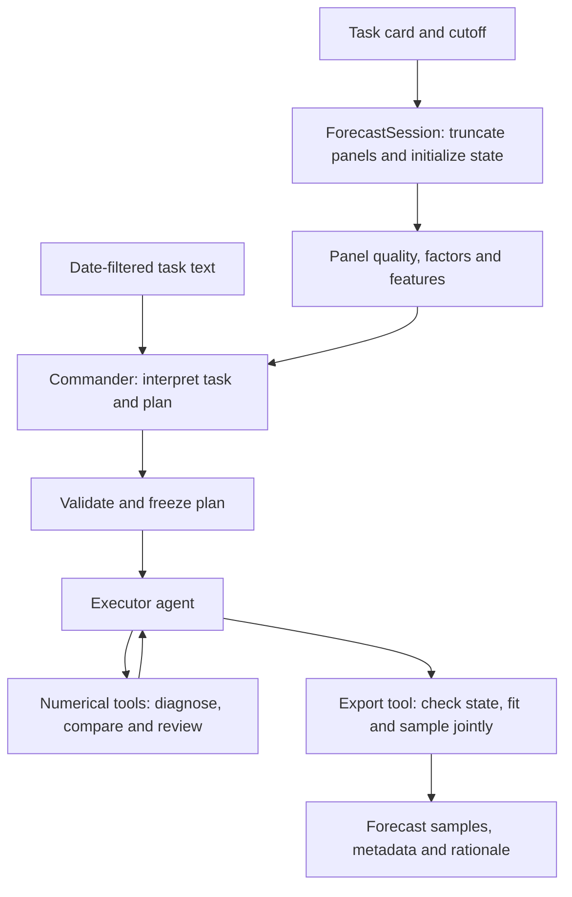

# Agenthon2026 Mars

[简体中文](README.md) · **English**

A probabilistic financial forecasting agent for Agenthon 2026 Track 2. A language model plans the workflow and orchestrates tools; numerical models fit the data, evaluate candidates, and generate joint samples across assets and forecast horizons.

## Agent design

### 1. Separate task interpretation from forecast execution

Each task supplies text and time-series panels. Text informs the analysis plan; panels support estimation and historical comparison. Mars uses two agents in sequence:

- **Commander:** reads eligible dated text and numerical analysis, then selects candidates, training windows, feature families, and ensemble weights.
- **Executor:** receives the validated plan and calls numerical tools for diagnosis, comparison, evidence review, and export.

Both agents share a model backend and request budget. Raw text stays in the commander stage; the executor proceeds through the plan and numerical results.



### 2. Connect the agents through a structured plan

The commander runs a bounded smolagents tool-calling loop with `inspect_data`, `compute_factors`, `data_quality`, and `build_features`, then returns a JSON plan.

| Decision | Enforced constraints |
| --- | --- |
| Candidates | Choose from `random_walk`, `gbm`, and `solution_ensemble`; retain the standalone random-walk candidate |
| Training window | 252 / 504 / 756 observations for daily tasks; 60 / 120 / 180 for monthly tasks |
| Feature families | Select rates / fx / factors / macro families present in the panel |
| Ensemble weights | Nonnegative component weights summing to 1, or `null` to delegate to historical errors |
| Evidence | Text quotes must match supplied excerpts; numerical changes require an analysis rationale |

`validate_plan` checks the plan. `ForecastSession.apply_workflow` freezes it once, before diagnosis and evaluation begin, so subsequent comparisons share candidate, window, and feature settings. Without eligible text, the commander can still use numerical analysis. Invalid plans or commander failures retain the default plan.

### 3. Make numerical tools produce decision evidence

The executor chooses its next action from tool results. Tools cover data inspection, statistical diagnosis, factors, features, random-walk evaluation, candidate comparison, evidence review, and export.

`ForecastSession` holds the plan, diagnosis status, cached candidate evaluations, and export status as working memory for one task. Tool traces and results are saved in an audit directory for inspection after the run.

Historical comparisons use chronological windows. The composite loss includes marginal, joint, and tail metrics, normalized by reconstructed public M0 error scales and aggregated with an arithmetic mean. Failed folds receive loss 8; losses are capped at 8. Evidence review reports paired fold wins and losses, worst degradation, failures, and changes in the recommendation after leaving out one time block.

The executor instructions ask it to compare all approved candidates and review the evidence. The export tool enforces completed diagnosis, successful evaluation of the selected model, and comparable evidence across multiple candidates. It also writes the evidence review into the rationale. Single-candidate exports are flagged.

### 4. Represent the forecast as a joint distribution

| Default candidate | Role and implementation |
| --- | --- |
| `random_walk` | A simple numerical reference using shared residual dates across assets and horizons |
| `gbm` | Direct-horizon prediction from lag, momentum, volatility, and selected cross-asset features; chronological residual blocks provide joint calibration |
| `solution_ensemble` | Random walk, damped trend, and a relative-price feature tree, with monthly seasonality, joint residual KDE, and whole-vector mixing |

The mixture samples entire asset–horizon vectors to preserve dependence within each component. The commander can set component weights, including a zero random-walk share, or delegate weighting to training-history errors. Failure of an explicitly weighted component raises an error rather than silently changing those weights.

Legacy statistical models and an experimental volatility model remain available for research; the default agent menu contains the three candidates above.

### 5. Inspect the controller through offline comparisons and run records

| Mode | Control flow |
| --- | --- |
| Default `--mode agent` | Commander plans → executor calls tools |
| `--mode agent --commander off` | Executor calls tools under the default plan |
| `--mode offline` | A fixed procedure diagnoses, evaluates default candidates, and selects by loss, without language-model calls |

Defaults are 4 commander steps, 8 executor steps, and a 300-second main-run budget. Both agents share request accounting. The House adapter sets a limit of 25 requests per task and 4000 output tokens per request. The process prints stage progress and a heartbeat every 10 seconds. Main-run failures trigger an attempt at public M0 reconstruction with a separate 30-second limit.

## Installation

Use Python 3.13 and Git. Run from this repository's root:

```bash
git clone https://github.com/Agenthon-2026/track2-forecasting-public.git
git -C track2-forecasting-public checkout 30c8019d997f930eab9ba569d089d12298d86d8c
python3.13 -m venv .venv-agent
source .venv-agent/bin/activate
python -m pip install -r requirements-dev.txt
```

The upstream checkout supplies task data and the scorer. The shared toolkit is pinned to v2.6.0. `requirements-*.lock.txt` records development-environment snapshots; use `requirements-dev.txt` for installation.

## Running

Offline forecasting and official format checks:

```bash
python tools/smoke_staged_unit.py --out runs/offline_smoke
python -m pytest tests -q
```

Local DeepSeek agent with hidden API-key input:

```bash
python -m numeric_agent forecast \
  --panels track2-forecasting-public/units/t2-F1-ai-mom-2024 \
  --text track2-forecasting-public/units/t2-F1-ai-mom-2024/text \
  --asof 2024-05-31 --out runs/local_agent/forecast.parquet --prompt-key
```

The default local model name is `deepseek-flash`; change it with `--model`. The platform House adapter reads `MODEL_ENDPOINT`, `MODEL_TOKEN`, and `MODEL_NAME` from the environment. Restricted competition networking disables the local DeepSeek route. Run `python tools/smoke_house_stub.py` to check the simulated House protocol.

Use a fresh output directory for each run. The forecast directory contains three files:

- `forecast.parquet`: joint forecast samples.
- `forecast_meta.json`: model, mode, and task metadata.
- `forecast_rationale.md`: forecast rationale and candidate evidence review.

Audit records go into a sibling directory, overridable through `QFBENCH_AUDIT_DIR`. Execution continues without an audit trail when no audit directory is writable. See the [submission guide (Chinese)](submission/README.md) for container building and packaging.

## Source reading guide

| File | Focus |
| --- | --- |
| [__main__.py](numeric_agent/__main__.py) | Mode selection, agent sequencing, timing, and fallback |
| [commander.py](numeric_agent/commander.py) | Text filtering, tool calls, and plan validation |
| [agent.py](numeric_agent/agent.py) | Executor tools and decision instructions |
| [engine.py](numeric_agent/engine.py) | Session state, frozen plans, historical evaluation, and export conditions |
| [features.py](numeric_agent/features.py) / [factors.py](numeric_agent/factors.py) | Time-varying features and economic indicators |
| [tree_forecast.py](numeric_agent/tree_forecast.py) / [solution_models.py](numeric_agent/solution_models.py) | Horizon prediction, joint calibration, and mixtures |
| [evaluation.py](numeric_agent/evaluation.py) / [evidence.py](numeric_agent/evidence.py) | Loss calculation and comparison evidence |
| [tests/](tests/) / [tools/](tools/) | Regression tests, backtests, and runtime checks |

`configs/` holds historical experiment configurations. `tools/local_score_predictor.py` requires separately supplied private historical source versions and `online_scores.json`.

## Validation status and limitations

On 2026-10-14, 110 project tests passed, and the offline daily task `t2-F1-conflicting-texts-2024` passed official gates g0–g3. That check did not call a real model API or rebuild a Docker image.

Historical windows serve model selection; independent forecast-accuracy validation remains outstanding. Historical evaluation does not replay text vintages, and macro release calendars and missing outcomes remain limitations. The real House service has not been verified locally. The current local calibration tool cannot reliably predict online scores.

## Credentials and dependencies

API keys and Team Keys enter through hidden prompts or environment variables. The packer uses a temporary Team Key file with mode 0600 and cleans it up on exit paths. `.gitignore` excludes run records, personal wiki pages, team claims, image configuration, and submission packages. The Docker build context contains only application source.

- [Agenthon Track 2](https://github.com/Agenthon-2026/track2-forecasting-public)
- [Agenthon public toolkit](https://github.com/Agenthon-2026/Agenthon2026-public)
- [smolagents](https://github.com/huggingface/smolagents)

Third-party code and data retain their respective licenses. This repository does not grant a separate source-code license.
