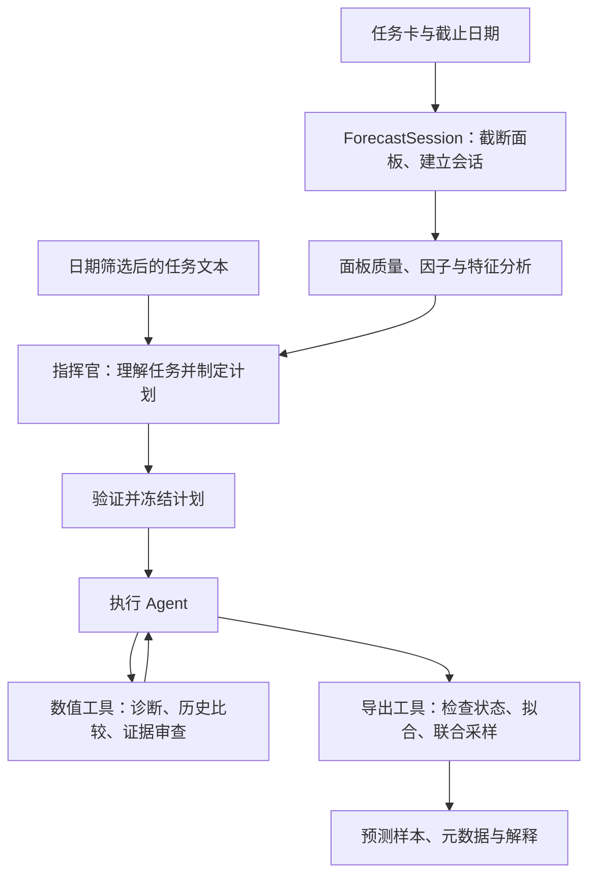

# Agenthon2026 Mars

**简体中文** · [English](README.en.md)

面向 Agenthon 2026 Track 2 的金融时间序列概率预测 Agent。语言模型负责制定计划与调度工具，数值模型负责拟合、验证和生成多资产、多期限的联合预测样本。

## 设计思路

### 1. 将任务理解与预测执行分成两个阶段

任务输入同时包含文本和时间序列面板。文本用于判断应采用什么分析计划，面板用于估计模型并比较历史误差。因此，Mars 采用顺序执行的两个 Agent：

- **指挥官**读取日期合规的文本及数值分析，选择候选模型、训练窗口、特征家族和组合权重。
- **执行 Agent**接收已验证的计划，通过数值工具完成诊断、模型比较、证据审查和导出。

两个 Agent 共享模型后端与请求预算。原始文本留在指挥官阶段，执行阶段通过计划和数值结果推进。



### 2. 用结构化计划连接两个 Agent

指挥官通过 smolagents 的有界工具调用循环读取 `inspect_data`、`compute_factors`、`data_quality` 和 `build_features`，最终返回 JSON 计划。

| 决策 | 代码中的约束 |
| --- | --- |
| 候选模型 | 从 `random_walk`、`gbm`、`solution_ensemble` 中选择，保留独立随机游走候选 |
| 训练窗口 | 日频 252 / 504 / 756 个观测；月频 60 / 120 / 180 个观测 |
| 特征家族 | 从面板实际存在的 rates / fx / factors / macro 中选择 |
| 组合权重 | 指定非负、总和为 1 的组件权重，或以 `null` 委托历史误差规则 |
| 决策依据 | 文本引用须匹配提供的原文；数值调整须给出分析理由 |

`validate_plan` 检查计划，`ForecastSession.apply_workflow` 在诊断与评估开始前一次性冻结计划。这样，后续比较使用同一组模型、窗口和特征设定。无合规文本时，指挥官仍可依据数值分析决策；计划无效或指挥官调用失败时保留默认计划。

### 3. 让数值工具产生可供决策的证据

执行 Agent 依据工具返回结果选择下一步。工具覆盖数据检查、统计诊断、因子分析、特征检查、随机游走评估、候选比较、证据审查和预测导出。

`ForecastSession` 保存当前计划、诊断状态、候选评估缓存和导出状态，作为单次任务的工作记忆。工具调用轨迹与结果写入审计目录，供运行后复查。

历史比较使用按时间排序的窗口。复合损失包含边际、联合和尾部指标，使用公开 M0 重建的误差尺度归一化后取算术平均；失败折损失为 8，上限为 8。证据审查汇总逐折胜负、最坏退化、失败情况，以及删去一个时间块后推荐模型是否变化。

执行 Agent 的指令要求比较批准的全部候选并审查证据；导出工具在代码层检查诊断已完成、所选模型已成功评估、多候选证据可比，并把审查记录写入解释文件。单候选导出会被标记。

### 4. 将预测表示为联合分布

| 默认候选 | 作用与实现 |
| --- | --- |
| `random_walk` | 简单数值参照，通过共享残差日期构造跨资产、跨期限样本 |
| `gbm` | 使用滞后、动量、波动率及选定的跨资产特征，直接预测各期限；按时间隔离的残差块用于联合校准 |
| `solution_ensemble` | 组合随机游走、阻尼趋势和相对价格特征树；包含月度季节性、联合残差 KDE 与整向量混合 |

组合时以整个资产—期限向量为单位抽样，保留组件内部的依赖结构。指挥官可以指定组件权重，随机游走的组合占比允许为 0；也可委托训练历史内的误差规则计算权重。显式指定的组件失败会报错，不自动改写权重。

旧统计模型与波动实验模型仍可用于研究，默认 Agent 菜单保持上述三个候选。

### 5. 用离线对照与运行记录检查控制流程

| 模式 | 控制流程 |
| --- | --- |
| 默认 `--mode agent` | 指挥官制定计划 → 执行 Agent 调用工具 |
| `--mode agent --commander off` | 执行 Agent 在默认计划下调用工具 |
| `--mode offline` | 固定流程诊断、评估默认候选并按损失选择，无语言模型调用 |

默认预算为指挥官 4 步、执行 Agent 8 步、主流程 300 秒。两个 Agent 共享请求计数；House 适配器设置每任务 25 次请求、单次最多 4000 输出 tokens。程序打印阶段进度及每 10 秒心跳，主流程失败后尝试限时 30 秒的公开 M0 重建回退。

## 安装

使用 Python 3.13 和 Git，从本仓库根目录运行：

```bash
git clone https://github.com/Agenthon-2026/track2-forecasting-public.git
git -C track2-forecasting-public checkout 30c8019d997f930eab9ba569d089d12298d86d8c
python3.13 -m venv .venv-agent
source .venv-agent/bin/activate
python -m pip install -r requirements-dev.txt
```

官方任务数据与评分器从上述仓库获取，共享工具包固定为 v2.6.0。`requirements-*.lock.txt` 保存开发环境依赖快照；安装入口为 `requirements-dev.txt`。

## 运行

离线预测与官方格式检查：

```bash
python tools/smoke_staged_unit.py --out runs/offline_smoke
python -m pytest tests -q
```

本地 DeepSeek Agent，通过隐藏输入读取 API Key：

```bash
python -m numeric_agent forecast \
  --panels track2-forecasting-public/units/t2-F1-ai-mom-2024 \
  --text track2-forecasting-public/units/t2-F1-ai-mom-2024/text \
  --asof 2024-05-31 --out runs/local_agent/forecast.parquet --prompt-key
```

本地模型默认名为 `deepseek-flash`，通过 `--model` 修改。平台 House 模型从环境读取 `MODEL_ENDPOINT`、`MODEL_TOKEN`、`MODEL_NAME`；受限比赛网络禁用本地 DeepSeek 路径。`python tools/smoke_house_stub.py` 可检查模拟 House 协议。

每次运行使用新输出目录，正式输出包含三个文件：

- `forecast.parquet`：联合预测样本。
- `forecast_meta.json`：模型、模式与任务元数据。
- `forecast_rationale.md`：预测解释及候选证据审查。

审计记录写入相邻目录，可通过 `QFBENCH_AUDIT_DIR` 指定；没有可写审计目录时继续运行。容器构建与打包见[提交说明](submission/README.md)。

## 源码阅读路线

| 文件 | 阅读重点 |
| --- | --- |
| [__main__.py](numeric_agent/__main__.py) | 模式选择、两个 Agent 的串联、计时与回退 |
| [commander.py](numeric_agent/commander.py) | 文本筛选、工具调用、计划验证 |
| [agent.py](numeric_agent/agent.py) | 执行 Agent 的工具菜单与决策指令 |
| [engine.py](numeric_agent/engine.py) | 会话状态、计划冻结、历史评估、导出条件 |
| [features.py](numeric_agent/features.py) / [factors.py](numeric_agent/factors.py) | 时变特征与经济指标 |
| [tree_forecast.py](numeric_agent/tree_forecast.py) / [solution_models.py](numeric_agent/solution_models.py) | 期限预测、联合校准与组合 |
| [evaluation.py](numeric_agent/evaluation.py) / [evidence.py](numeric_agent/evidence.py) | 损失计算与比较证据 |
| [tests/](tests/) / [tools/](tools/) | 回归测试、回测与运行检查 |

`configs/` 保存历史实验配置。`tools/local_score_predictor.py` 需要另外提供私有历史版本源码与 `online_scores.json`。

## 验证状态与限制

2026-10-14：110 项自有测试通过；日频任务 `t2-F1-conflicting-texts-2024` 离线流程通过官方 g0–g3 门禁。该次检查未调用真实模型 API 或重建 Docker 镜像。

历史窗口用于择模，尚缺独立预测准确度验证；历史评估未重放文本 vintage，宏观发布日历与缺失真值处理仍有限制。真实 House 服务尚未在本地验证，线上分数无法由当前本地校准工具可靠预测。

## 凭据与依赖

API Key、Team Key 通过隐藏输入或环境变量传入。打包器使用权限为 0600 的临时 Team Key 文件，并在退出路径清理。运行记录、个人 Wiki、队伍声明、镜像配置和提交包由 `.gitignore` 排除；Docker 构建上下文只包含应用源码。

- [Agenthon Track 2](https://github.com/Agenthon-2026/track2-forecasting-public)
- [Agenthon 公共工具包](https://github.com/Agenthon-2026/Agenthon2026-public)
- [smolagents](https://github.com/huggingface/smolagents)

第三方代码与数据遵循各自许可。本仓库未另行授予源码许可证。
